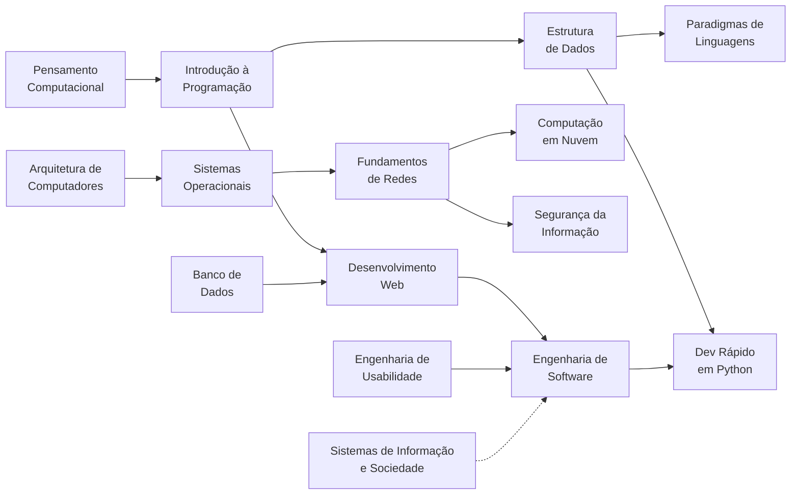

<div align="center">

# studium.dev

### O caderno que a faculdade nunca me deu.

*Um acervo vivo de tudo o que aprendi — e do que ainda estou aprendendo.*


</div>

---

## O problema que me fez criar isso

A faculdade entrega muita coisa ao mesmo tempo.

Em um semestre eu atravesso redes, banco de dados, engenharia de software e arquitetura de computadores. No semestre seguinte, tudo isso vira uma pasta esquecida no Drive — se tanto. A disciplina acaba, a prova passa e o conteúdo evapora. Fica só a vaga lembrança de *"eu já estudei isso em algum lugar"*.

E existe uma segunda perda, mais silenciosa: **eu não consigo enxergar as conexões**. Sei que aprendi redes. Sei que aprendi segurança. Mas em que momento uma coisa explica a outra? Onde o banco de dados conversa com a engenharia de software? Como a arquitetura de computadores aparece quando meu código fica lento?

O caderno não resolve isso. Ele guarda páginas em ordem de aula, não em ordem de **sentido**. Ele não deixa buscar. Não deixa filtrar. Não deixa ver o mapa inteiro de uma vez — e some no fundo da mochila.

> **studium.dev** é a resposta que eu queria ter tido no primeiro semestre.
> Não é um caderno digitalizado. É um acervo **navegável**: cada disciplina tem um lugar, cada tema tem um contexto, e a aplicabilidade deixa de ser abstrata porque está escrita ao lado do conceito.

---

## A ideia

Não quero guardar conteúdo. Quero guardar **entendimento**.

Por isso cada disciplina aqui não é um monte de PDFs jogados numa pasta. É uma página que responde a três perguntas:

| Pergunta | O que ela força |
| :--- | :--- |
| **O que é isso?** | o conceito, em uma frase que eu entenderia daqui a cinco anos |
| **Por que isso importa?** | a ponte com o mundo real, com o trabalho e com as outras disciplinas |
| **Onde eu aplico?** | exemplos, exercícios e projetos que provam que não é só teoria |

É a diferença entre *"eu tive aula de sistemas operacionais"* e *"eu sei por que meu processo travou quando a memória acabou"*.

---

## Como navegar

### Por trilha

O acervo agrupa as disciplinas por **área de conhecimento**, não por ordem alfabética ou por semestre. Assim, o que é próximo aparece junto.

| Trilha | Disciplinas |
| :--- | :--- |
| 🧠 **Fundamentos da Computação** | Pensamento Computacional · Introdução à Programação · Estrutura de Dados · Arquitetura de Computadores · Paradigmas de Linguagens |
| 🌐 **Infraestrutura & Segurança** | Fundamentos de Redes · Sistemas Operacionais · Computação em Nuvem · Segurança da Informação |
| 🗄️ **Dados & Web** | Banco de Dados · Desenvolvimento Web (HTML5, CSS, JS e PHP) |
| 🛠️ **Engenharia & Produto** | Engenharia de Software · Engenharia de Usabilidade · Desenvolvimento Rápido em Python |
| 🏛️ **Tecnologia & Sociedade** | Sistemas de Informação e Sociedade |

### Pelo mapa

O grafo abaixo é o coração do projeto: mostra como um assunto puxa o outro. É a resposta visual para *"onde isso se conecta?"*.



---

## Estrutura do repositório

```text
studium-dev/
├── README.md                  ← você está aqui
├── ROADMAP.md                 ← próximos passos e ideias de gamificação
├── preview/
│   └── index.html             ← protótipo visual (abra no navegador)
├── materiais/                 ← caixa de entrada dos PDFs e anotações brutas
│   ├── _entrada/
│   └── <disciplina>/
└── disciplinas/
    ├── _template/             ← molde usado para novas disciplinas
    ├── pensamento-computacional/
    │   └── README.md
    ├── introducao-programacao-computadores/
    ├── fundamentos-redes-computadores/
    ├── introducao-seguranca-da-informacao/
    ├── computacao-em-nuvem/
    ├── desenvolvimento-web/
    ├── estrutura-de-dados/
    ├── arquitetura-de-computadores/
    ├── banco-de-dados/
    ├── paradigmas-linguagens-python/
    ├── desenvolvimento-rapido-python/
    ├── sistemas-operacionais/
    ├── engenharia-de-usabilidade/
    ├── engenharia-de-software/
    └── sistemas-informacao-sociedade/
```

Cada pasta de disciplina segue o mesmo contrato: um `README.md` com o resumo, o "porquê" e os índices de resumos, exercícios e projetos. O conteúdo cresce **dentro** dessa estrutura — nunca solto.

---

## Princípios do acervo

1. **Legível primeiro.** Se eu não conseguir reler e entender em dois anos, não está bom.
2. **Contexto acima de volume.** Um parágrafo que conecta vale mais que dez páginas copiadas.
3. **Versionado.** Tudo é Git. Cada melhoria é um commit, cada revisão é um histórico.
4. **Em construção por definição.** Um acervo que para de crescer é um acervo morto.
5. **Pessoal, mas público.** Serve para mim hoje e para quem quiser consultar amanhã.

---

## Status

| # | Disciplina | Trilha | Situação |
| :-: | :--- | :--- | :--- |
| 01 | Pensamento Computacional | Fundamentos | 🔵 com resumos |
| 02 | Introdução à Programação de Computadores | Fundamentos | 🔵 com resumos |
| 03 | Fundamentos de Redes de Computadores | Infraestrutura | 🔵 com resumos |
| 04 | Introdução à Segurança da Informação | Infraestrutura | 🔵 com resumos |
| 05 | Computação em Nuvem | Infraestrutura | 🔵 com resumos |
| 06 | Desenvolvimento Web em HTML5, CSS, JavaScript e PHP | Dados & Web | 🟡 estruturando |
| 07 | Estrutura de Dados | Fundamentos | 🟡 estruturando |
| 08 | Arquitetura de Computadores | Fundamentos | 🟡 estruturando |
| 09 | Banco de Dados | Dados & Web | 🟡 estruturando |
| 10 | Paradigmas de Linguagens de Programação em Python | Fundamentos | 🟡 estruturando |
| 11 | Desenvolvimento Rápido de Aplicações em Python | Engenharia | 🟡 estruturando |
| 12 | Sistemas Operacionais | Infraestrutura | 🟡 estruturando |
| 13 | Engenharia de Usabilidade | Engenharia | 🟡 estruturando |
| 14 | Engenharia de Software | Engenharia | 🟡 estruturando |
| 15 | Sistemas de Informação e Sociedade | Sociedade | 🟡 estruturando |

**Legenda:** ⬜ vazia · 🟡 estruturando · 🟢 com materiais · 🔵 com resumos · 🟣 com projeto

---

## Prévia visual

`preview/index.html` é o site, sem build de front-end e sem dependência: abra o arquivo
no navegador.

- **A fazenda** — o acervo como lugar, dividido em três áreas. Cada construção é uma
  disciplina: a sementeira, o silo, a roda d'água, a prefeitura, o coreto, o moinho,
  a ponte. Clique e a disciplina abre.
- **Canteiros** — a mesma informação em forma de lista, com busca e filtro por trilha.
- **Leitor** — clique em uma disciplina e escolha um resumo: ele abre dentro do site,
  com navegação entre os temas.
- **Link direto** — cada disciplina e cada resumo tem endereço próprio, por exemplo
  `#/fundamentos-redes-computadores/03`. Funciona com voltar/avançar do navegador, e o
  leitor tem um botão "copiar link".
- **Dia e noite** — o botão no topo troca a iluminação da cena.
- Tudo em pixel art autoral desenhada em SVG: nada de asset de terceiros.

### O conteúdo vem do Markdown

O site não guarda texto próprio. Um script lê os `README.md` e os `resumos/*.md` de cada
disciplina e gera `preview/conteudo.js`:

```bash
npm run build
```

O Markdown continua sendo a **fonte da verdade**; o arquivo gerado é versionado para que
o site funcione mesmo aberto direto do disco. O GitHub Actions roda o mesmo comando a
cada push e falha se alguém esquecer de regenerar.

## Próximo passo

O esqueleto e a camada visual existem. Agora o acervo precisa de **substância**: os
materiais da faculdade entram em `materiais/<disciplina>/`, são resumidos e viram
Markdown em `disciplinas/<disciplina>/`.

Quando houver conteúdo, a camada visual passa a ler os próprios Markdowns — busca,
leitura e mapa de conexões alimentados pela fonte da verdade, sem duplicar texto.

O conteúdo continua sendo Markdown puro, legível direto aqui no GitHub. O site é só uma camada por cima.

O plano de evolução está em [ROADMAP.md](ROADMAP.md) — incluindo a ideia de transformar
consulta em progresso com XP, simulados, conquistas e a fazenda evoluindo junto.

---

<div align="center">
<sub>Feito com dúvidas, anotações e a teimosia de não esquecer.</sub>
</div>
